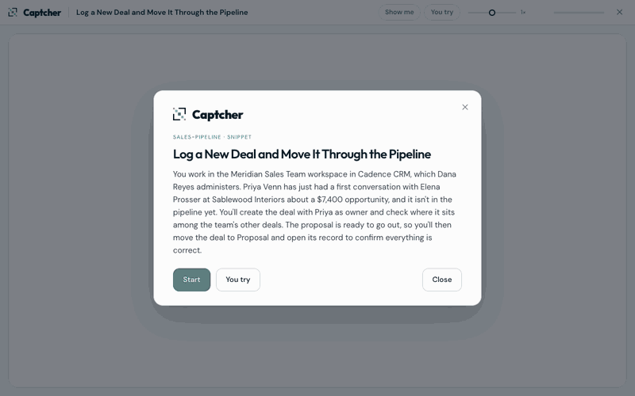

# Captcher

[](https://github.com/wwiens/captcher/actions/workflows/ci.yml)
[](LICENSE)

**Do a task once in your browser; get an interactive walkthrough anyone can
practise on.** A Chrome extension captures each screen as you work. Claude, with
your own Anthropic API key, writes the steps, instructions and hints. The
player replays it over the frozen pages, as a demo (**Show me**) or as
something the learner does themselves (**You try**), and it exports as a single
HTML file, a folder, or a SCORM package for your LMS.



Captcher is self-hosted and single-user: no accounts, no sign-up. Walkthroughs
live in a SQLite file and the captured pages in a folder, both under
`~/.captcher`. The only outside service is the Anthropic API, for the AI passes.

Try one first: [`examples/`](examples/) has four finished walkthroughs and
every export format, and they play offline. Guides:
[recording](docs/recording.md) and [sharing and embedding](docs/sharing.md).

## Quick start

You need [uv](https://docs.astral.sh/uv/getting-started/installation/) (it
fetches Python for you) and desktop Google Chrome.

1. **Install Captcher**, server and recorder together:

   ```bash
   uv tool install captcher
   ```

   (`pipx install captcher` works too. For the unreleased code on `main`:
   `uv tool install "git+https://github.com/wwiens/captcher#subdirectory=server"`.)

2. **Start it:**

   ```bash
   captcher
   ```

   It creates `~/.captcher`, starts on `http://127.0.0.1:8080` and opens the
   setup guide in your browser. Leave it running.

3. **Load the recorder into Chrome.** Open `chrome://extensions`, turn on
   **Developer mode**, click **Load unpacked** and choose the folder this
   prints:

   ```bash
   captcher extension
   ```

   It is inside a hidden folder (`~/.captcher/extension`): on a Mac press
   <kbd>Cmd</kbd>+<kbd>Shift</kbd>+<kbd>G</kbd> in the dialog and paste the
   path. Pin **Captcher Recorder** from Chrome's puzzle-piece menu.

4. **Connect it.** With the Captcher tab active, click the recorder's toolbar
   icon. The side panel connects to Captcher by itself and shows **Connected**.

5. **Record.** Open the app you want to teach, give the task a title, press
   **Start recording**, do the task, then **Finish & submit**. The recording
   appears on Captcher's Walkthroughs page as a draft.

6. **Let Claude write it.** Add your
   [Anthropic API key](https://console.anthropic.com/settings/keys) to
   `~/.captcher/.env`. The line is already there; paste the key straight after
   the `=`:

   ```
   ANTHROPIC_API_KEY=sk-ant-...
   ```

   Restart `captcher`, then press **Author with AI** on the draft. Authoring is
   billed to your Anthropic account; **AI spend** in Captcher shows what each
   pass cost.

Upgrading: `uv tool upgrade captcher`, restart it, then press the reload arrow on
Captcher Recorder in `chrome://extensions`. The folder stays the same, so the
recorder stays connected.

## Commands

| Command | What it does |
|---|---|
| `captcher` | Start Captcher and open it in your browser. `--port 9000`, `--no-browser`, `--host` (see below), `--dev` |
| `captcher extension` | Print the folder to load into Chrome |
| `captcher install-browser` | Download headless Chromium (about 200 MB) for the optional render and replay checks |
| `captcher token [LABEL]` | Mint a capture token for scripted uploads (`Authorization: Bearer …`) |
| `captcher devices` / `captcher revoke ID` | List or revoke the browsers and tokens that can upload |

**Optional checks.** The review page can re-render every captured page and
replay every step in a headless browser. That needs Playwright, which is big,
so it is an extra:

```bash
uv tool install --force "captcher[verify]"
captcher install-browser
```

**Sharing on a network.** Captcher has no accounts: whoever can reach it owns
everything in it. So it listens only on this computer unless you set an access
token in `~/.captcher/.env` (`CAPTCHER_ACCESS_TOKEN=…`) and start it with
`captcher --host 0.0.0.0`. Each browser then enters the token once at `/unlock`.
The recorder only talks to another machine over https, so put a TLS proxy in
front.

## Your data

| In `~/.captcher` | |
|---|---|
| `.env` | your settings; every option is in [`server/.env.example`](server/.env.example) |
| `captcher.db` | walkthroughs, collections, brand profiles, connected browsers, AI spend |
| `captures/` | every captured page and screenshot |
| `extension/` | the recorder Chrome loads (replaced on upgrade; don't edit it) |
| `session_secret` | signs this server's cookies |

Back up the folder to back up Captcher. `export CAPTCHER_HOME=/somewhere/else`
moves all of it.

## Layout

| Folder | What it is |
|---|---|
| `server/` | The Python server: catalog, AI authoring, player, exports. Package `captcher`. |
| `extension/` | The Chrome (MV3) recorder extension. No build step. |
| `docs/` | Documentation, including the server/extension wire contract. |
| `examples/` | Finished walkthroughs you can open in a browser without installing anything. |

## Development

The short version is below; [CONTRIBUTING.md](CONTRIBUTING.md) has the rest.

```bash
git clone https://github.com/wwiens/captcher && cd captcher/server
uv sync --extra dev
uv run captcher --dev          # restarts when the Python code changes
uv run pytest
```

From a checkout, Captcher uses the repository's `extension/` folder directly,
so Load unpacked that folder and your edits show up when you reload it. Set
`CAPTCHER_HOME` to keep development data apart from your own.

```bash
cd extension && node --test tests/*.test.cjs
```

## Licence

Captcher, Copyright (C) 2026 Noventix LLC, is free software under the
[GNU Affero General Public License v3.0 or later](LICENSE).

It bundles [SingleFile](https://github.com/gildas-lormeau/SingleFile) (AGPL-3.0)
in the extension, and the DM Sans, Outfit, JetBrains Mono and Sora typefaces
(SIL Open Font License 1.1, texts beside the font files). See
`extension/THIRD-PARTY-NOTICES.md` and `server/captcher/static/fonts/PROVENANCE.md`.
