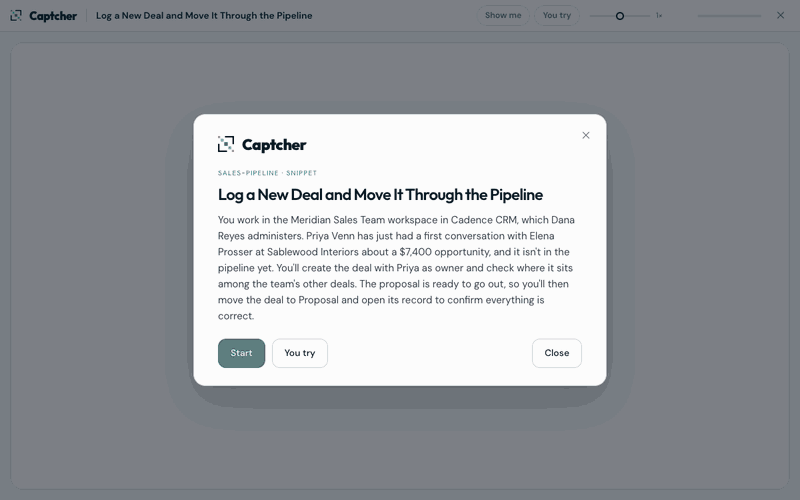

# Captcher

Record a task in your browser once and turn it into an interactive training
walkthrough. A Chrome extension captures each screen as you work; Claude, with
your own Anthropic API key, writes the steps, instructions and hints; the
player replays it over the frozen pages, either as a demo (**Show me**) or as
something the learner does themselves (**You try**). Walkthroughs export as a
single HTML file, a folder, or a SCORM package for your LMS.



Captcher runs on your own computer. Walkthroughs live in a SQLite file and the
captured pages in a folder under `~/.captcher`. Nothing leaves your machine
except the AI passes, which call the Anthropic API with your key.

## Get started

You need [uv](https://docs.astral.sh/uv/getting-started/installation/) and
desktop Google Chrome.

```bash
uv tool install "git+https://github.com/wwiens/captcher#subdirectory=server"
captcher
```

`captcher` opens a setup guide in your browser that walks through loading the
recorder into Chrome and making your first recording. The
[README](https://github.com/wwiens/captcher#quick-start) has the same steps.

## Guides

- [Recording a walkthrough](recording.md): what gets captured, what is
  redacted, and how to get a recording the AI pass can write up well.
- [Sharing a walkthrough](sharing.md): HTML, folder and SCORM exports, and
  embedding a walkthrough in your own site.

## Try one without installing

The [examples](https://github.com/wwiens/captcher/tree/main/examples) folder
has four finished walkthroughs and every export format. Download the folder and
open `examples/index.html`.

## For developers

- [CONTRIBUTING.md](https://github.com/wwiens/captcher/blob/main/CONTRIBUTING.md):
  setup, tests and code style.
- [The server/extension contract](https://github.com/wwiens/captcher/blob/main/docs/contract.md)
  and [how pairing works](https://github.com/wwiens/captcher/blob/main/docs/pairing.md).

Captcher is free software under the
[GNU AGPL v3](https://github.com/wwiens/captcher/blob/main/LICENSE).
